<a href="https://www.0xnavarro.com/">
  <picture>
    <source media="(prefers-color-scheme: dark)" srcset="assets/hero-dark.svg">
    
  </picture>
</a>

  <a href="https://www.0xnavarro.com/"><b>0xnavarro.com</b></a> &nbsp;·&nbsp;
  <a href="https://www.0xnavarro.com/en/writing/">Writing</a> &nbsp;·&nbsp;
  <a href="https://www.linkedin.com/in/0xnavarro/">LinkedIn</a> &nbsp;·&nbsp;
  <a href="mailto:info@0xnavarro.com">info@0xnavarro.com</a>

 

I've built technology since school: a first job in connected hardware while still a student, my first company in Madrid, CTO of a startup in Zurich, Head of IT Systems at a hospital in Mexico City, and Maria, a GPT-3 assistant on WhatsApp that reached 20,000+ users by word of mouth. Today I lead two companies in markets where complexity is the barrier, healthcare and the way companies run, and I still design and build the technology myself. This page is the technical side; the rest is on [0xnavarro.com](https://www.0xnavarro.com/).

## Building now

###  Vitalink · the action layer for healthcare

**Co-founder, CEO & CTO, since 2025.** Healthcare isn't short of doctors; it's fragmented. Vitalink connects every person, and their own health agent, with doctors, hospitals and providers, on one identity, one verified credential and one record. The mission is to give every person an agent that works for their health. We start in Mexico, inside the doctor's office.

| | Product | What it does |
|:--|:--|:--|
| Live | [**Expediente Vitalink**](https://expediente.vitalink.lat/) | The doctor's whole practice in one record. An agent runs the schedule, confirms visits and follows up; a consult assistant drafts the note for the doctor to review and sign. The model never receives the patient's name or contact details, and the audio is deleted once transcribed. |
| Live | [**Vitalink credential**](https://expediente.vitalink.lat/credencializacion) | Verifies a doctor's professional licence, identity and documents, at no cost on any plan. |
| Live | [**Vitalink Pay**](https://pay.vitalink.chat/) | Credentialed doctors charge in cash, in monthly instalments or split across family members. |
| Beta | [**Vitalink Chat**](https://www.vitalink.chat/) | Each person's own health agent. |
| By invitation | [**Red Vitalink · Doctor Asesor**](https://vitalink.lat/medicos) | The plan for surgeons and specialists, and the plan for GPs who accompany a patient's case from start to finish. |
| From 2 Feb 2027 | [**Paquetes Vitalink · Vitalink for Hospitals**](https://vitalink.lat/productos/hospitales) | The whole surgery at a closed price in three DRG scenarios (no complication, complication, major complication), paid before admission and settled at discharge with the scenario that happened. |

*The agent works; the doctor practises.* &nbsp; [**vitalink.lat →**](https://vitalink.lat)

###  Brida · build your company by talking

**Founder & CEO, since 2026.** Brida is the all-in-one infrastructure for a company that runs itself. You ask for what the company needs, whether portals, agents, processes, dashboards or websites, and Brida builds it on the company's own data and puts it to work. It runs from Brida or from Claude, ChatGPT, Cursor and any MCP client. Its first job is sales.

[**brida.ai →**](https://www.brida.ai/) &nbsp;·&nbsp; #12 of the top 100 AI startups in Estonia ([F6S](https://www.f6s.com/companies/artificial-intelligence/estonia/co), Nov 2026)

## How I build

<picture>
  <source media="(prefers-color-scheme: dark)" srcset="assets/method-dark.svg">
  
</picture>

- **Specs before code.** Every change starts as an issue and a written requirement. Agents implement it in isolated worktrees, one reviewable pull request at a time.
- **Gates decide what ships.** Tests, CI and review, automated and human, decide what merges.
- **Publish the receipts.** Benchmarks ship their corpora, failures and limits, not just a headline number.
- **People own the decisions.** Agents do the work. Anything that spends money, reaches a customer or changes scope comes back to a person.

The method is public: the essay [Founder-Led Engineering Ops](https://www.0xnavarro.com/en/writing/founder-led-engineering-ops/), the template [AI Software Bootstrap](https://github.com/0xnavarro/ai-software-bootstrap) and the scaffolder [create-qa-ops](https://github.com/0xnavarro/qa-ops).

## Open work

Most of what I build lives in private company repositories. This is the public part.

**Evaluation research, at Brida**

- [**ReflexBench**](https://github.com/brida-ai/reflexbench) · `v1.0.0 stable`. An open benchmark and harness for typed decision models, with frozen corpora, calibration metrics, paired bootstrap intervals and a public failure ledger.
- [**AlignmentBench**](https://github.com/brida-ai/alignmentbench) · `v0.1 preview`. Tests whether an AI system stays inside explicit authority, scope and oversight rules at the moment it chooses an action.

**Engineering method**

- [**AI Software Bootstrap**](https://github.com/0xnavarro/ai-software-bootstrap). How I run agent-assisted engineering, as a template: issues, specs, plans, worktrees, CI gates and review.
- [**create-qa-ops**](https://github.com/0xnavarro/qa-ops) · `npm`. `npx create-qa-ops` scaffolds findings, audits, QA sessions and merge gates that agents can read and run.

**Open-source contributions**

- [**withastro/flue #69**](https://github.com/withastro/flue/pull/69) · `merged`. Added a reasoning-effort option for prompts, skills and tasks to the SDK of Flue, the sandbox agent framework from the Astro team.

**Earlier applied AI**

- [**ADSA**](https://github.com/AteneaLabs/adsa) · `2024`. Autonomous data-science agents: o1 writes the ML code, Claude 3.5 Sonnet debugs it, a coordinator runs the loop. Placed 71st of 2,461 active participants on Kaggle's Spaceship Titanic.
- [**Speech to Text**](https://github.com/0xnavarro/speech-to-text). Real-time, multilingual speech-to-text in the browser.
- [**IA-PARA-TODOS**](https://github.com/0xnavarro/IA-PARA-TODOS). An open collection of AI apps and tutorials in Spanish (archived).

## Path

<picture>
  <source media="(prefers-color-scheme: dark)" srcset="assets/path-dark.svg">
  
</picture>

## Writing

- [What a Startup CEO Does](https://www.0xnavarro.com/en/writing/what-a-startup-ceo-does/): making the company worth more, and why Vitalink starts small to go global.
- [Founder-Led Engineering Ops](https://www.0xnavarro.com/en/writing/founder-led-engineering-ops/): a spec-driven, agent-orchestrated way to build software with human governance.
- [You Cannot Just Say an AI Is Aligned. You Have to Measure It.](https://www.0xnavarro.com/en/writing/you-cannot-just-say-an-ai-is-aligned-you-have-to-measure-it/): the thinking behind AlignmentBench.
- [The Miniaturization of the Firm](https://www.0xnavarro.com/en/writing/the-miniaturization-of-the-firm/): AI doesn't eliminate the company. It compresses it.

## Build log

<picture>
  <source media="(prefers-color-scheme: dark)" srcset="assets/build-log-dark.svg">
  
</picture>

 
 

  <picture>
    <source media="(prefers-color-scheme: dark)" srcset="assets/signoff-dark.svg">
    
  </picture>

