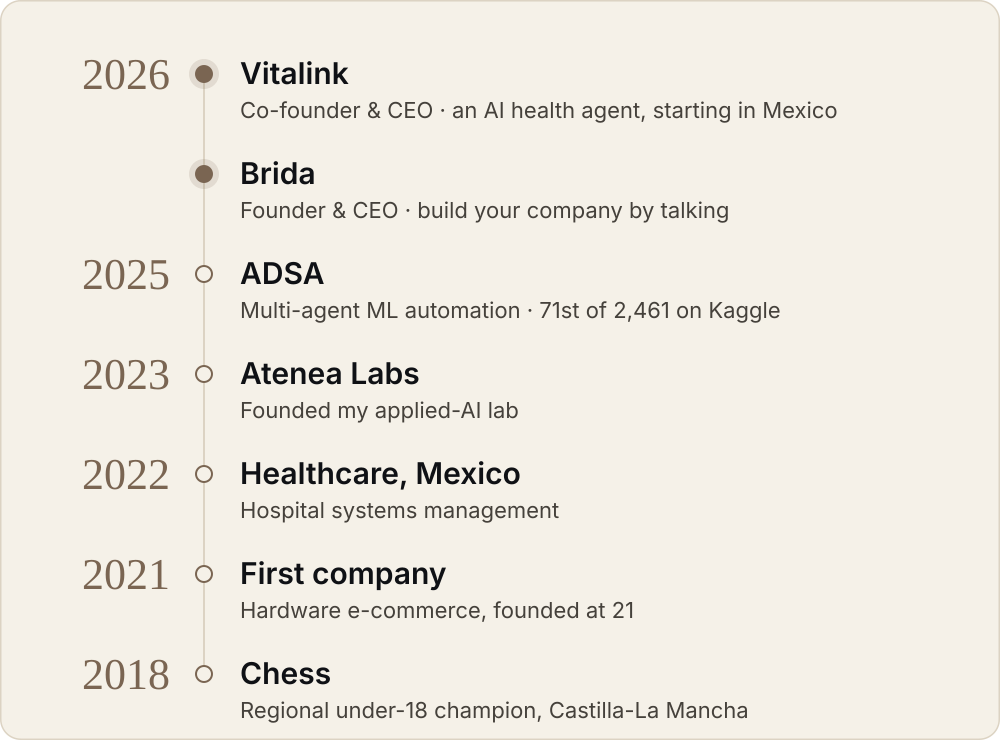
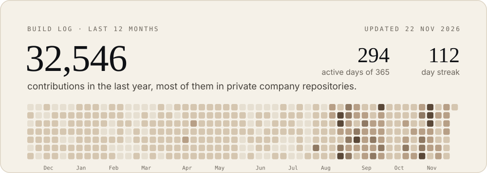

<a href="https://www.0xnavarro.com/">
  <picture>
    <source media="(prefers-color-scheme: dark)" srcset="assets/hero-dark.svg">
    
  </picture>
</a>

  <a href="https://www.0xnavarro.com/"><b>0xnavarro.com</b></a> &nbsp;·&nbsp;
  <a href="https://www.linkedin.com/in/0xnavarro/">LinkedIn</a> &nbsp;·&nbsp;
  <a href="https://x.com/0xnavarro">X</a> &nbsp;·&nbsp;
  <a href="mailto:info@0xnavarro.com">info@0xnavarro.com</a>

 

I'm Carlos. I started my first company at 21 and have been building companies, and the software behind them, ever since. I set the product direction, design the architecture and write code. Today AI agents do much of the implementation, inside specs, tests and review gates that I own.

Right now I'm building two independent companies.

## Building now

###  Vitalink: the action layer for healthcare

**Co-founder & CEO.** Vitalink gives every person an agent that works for their health. We're starting with surgery in Mexico: the agent finds surgeons, requests and compares quotes at the full price, and books the assessment, over WhatsApp or the web and free for patients. Inside the clinic, doctors already use [Expediente Vitalink](https://expediente.vitalink.lat/), our electronic health record.

[**vitalink.chat →**](https://www.vitalink.chat/)

###  Brida: build your company by talking

**Founder & CEO.** Brida is the all-in-one infrastructure for a company that runs itself. You ask for what your company needs, whether portals, agents, processes, dashboards or websites, and Brida builds it on the company's own data and puts it to work. Its first job is sales: getting new customers and winning back old ones.

[**brida.ai →**](https://www.brida.ai/) &nbsp;·&nbsp; #12 of the top 100 AI startups in Estonia ([F6S](https://www.f6s.com/companies/artificial-intelligence/estonia/co), Nov 2026)

## How I build

<picture>
  <source media="(prefers-color-scheme: dark)" srcset="assets/method-dark.svg">
  
</picture>

- **Specs before code.** Every change starts as an issue and a written requirement. Agents implement it in isolated worktrees, one reviewable pull request at a time.
- **Gates decide what ships.** Tests, CI and review, both automated and human, decide what merges. Confidence alone doesn't.
- **Publish the receipts.** My benchmarks ship their corpora, failures and limits, not just a headline number.
- **People own the decisions.** Agents do the work. Anything that spends money, reaches a customer or changes scope comes back to a person.

## Open work

Most of what I build lives in private company repositories. This is the public part:

- **[ReflexBench](https://github.com/brida-ai/reflexbench)** · `v1.0.0 stable` 
  An open benchmark and harness for typed decision models, with frozen corpora, calibration metrics, paired bootstrap intervals and a public failure ledger.
- **[AlignmentBench](https://github.com/brida-ai/alignmentbench)** · `v0.1 preview` 
  Tests whether an AI system stays inside explicit authority, scope and oversight rules at the moment it chooses an action.
- **[AI Software Bootstrap](https://github.com/0xnavarro/ai-software-bootstrap)** 
  How I run agent-assisted engineering, packaged as a template: issues, specs, plans, worktrees, CI gates and review.
- **[create-qa-ops](https://github.com/0xnavarro/qa-ops)** · `npm` 
  `npx create-qa-ops` scaffolds findings, audits, QA sessions and merge gates that agents can read and run.
- **[ADSA](https://github.com/AteneaLabs/adsa)** 
  A multi-agent system that automates a machine-learning workflow end to end. It placed 71st of 2,461 active participants on Kaggle's Spaceship Titanic.
- **[Speech to Text](https://github.com/0xnavarro/speech-to-text)** 
  Real-time, multilingual speech-to-text in the browser, built at Atenea Labs.

Earlier public projects

 

- [IA-PARA-TODOS](https://github.com/0xnavarro/IA-PARA-TODOS): an open collection of AI apps and tutorials in Spanish (archived).
- [Aave Liquiditor](https://github.com/0xnavarro/Aave-Liquiditor): a liquidation bot for Aave v3 on Arbitrum (archived).

## Path

<picture>
  <source media="(prefers-color-scheme: dark)" srcset="assets/path-dark.svg">
  
</picture>

## Build log

<picture>
  <source media="(prefers-color-scheme: dark)" srcset="assets/build-log-dark.svg">
  
</picture>

 
 

  <picture>
    <source media="(prefers-color-scheme: dark)" srcset="assets/signoff-dark.svg">
    
  </picture>

